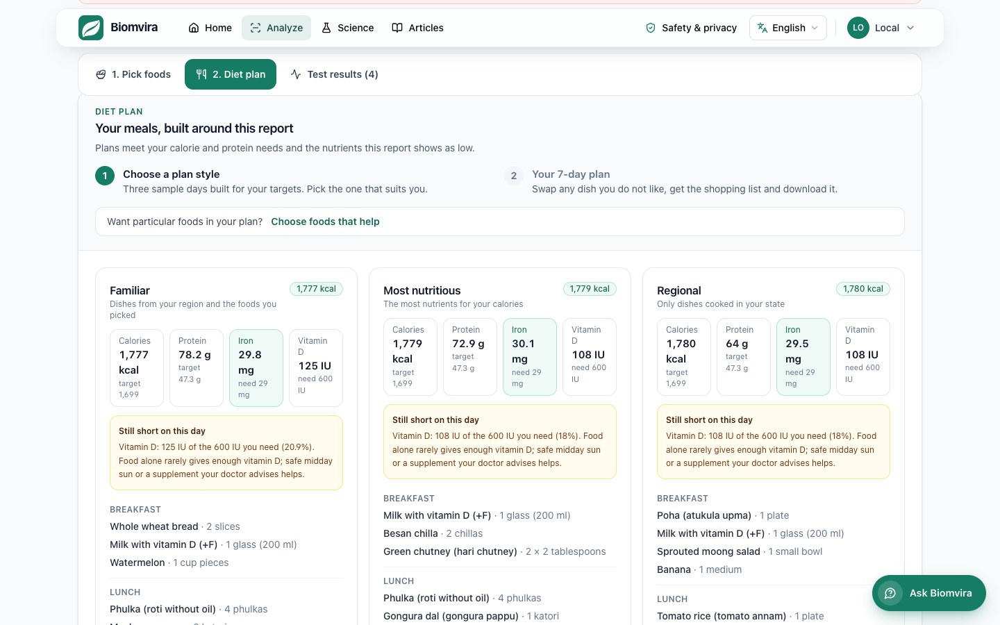
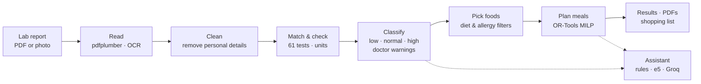
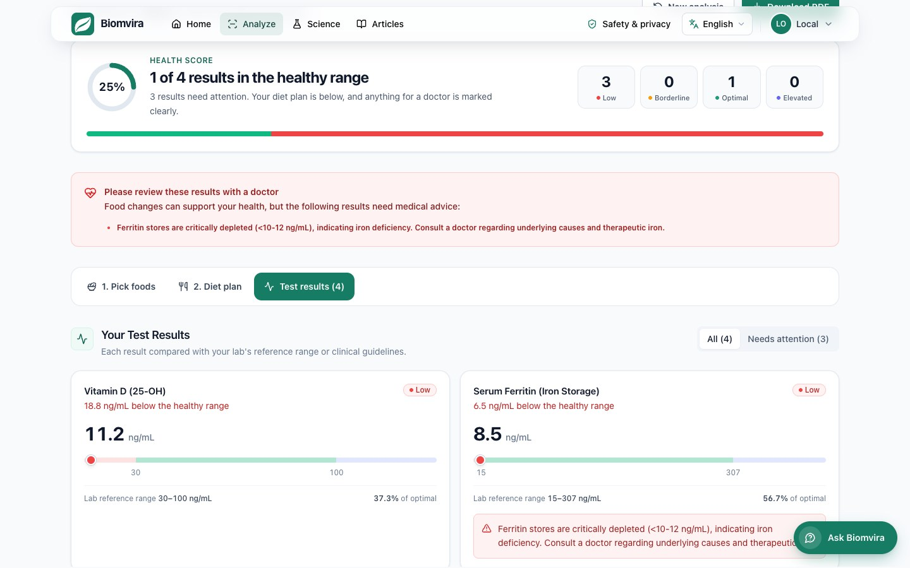
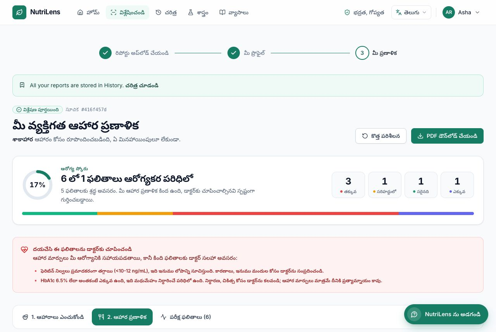
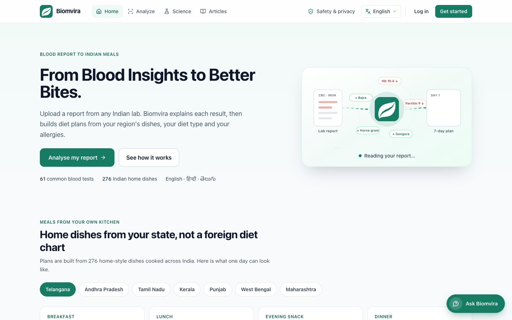
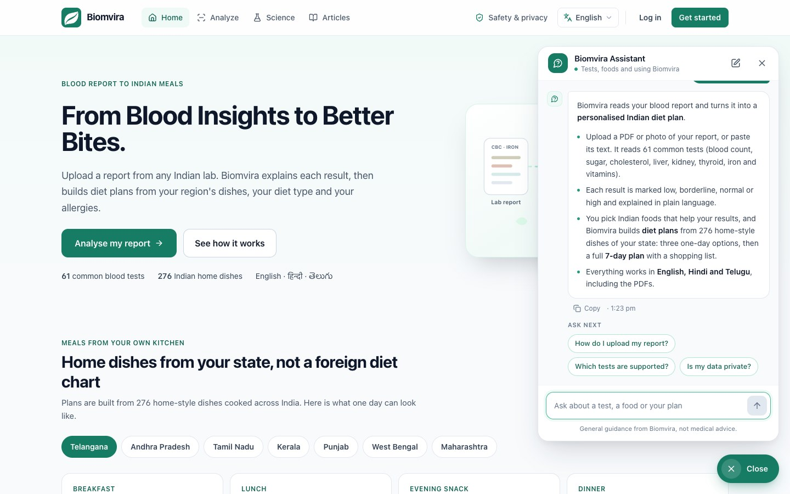

<div align="center">

# 🌿 NutriLens

### Personalised Indian diet plans from your blood report

Upload a lab report. NutriLens reads it, explains every result, and plans a day or a week of Indian home meals<br>
that fit your needs, diet, allergies, region and language.

[**Live demo**](https://nutrilens-sand.vercel.app/) · [How it works](#how-it-works) · [Results](#results) · [Getting started](#getting-started) · [API](#api-overview)




</div>

---

## Why NutriLens

A blood report tells you **what is low**. It doesn't tell you **what to cook on Monday**. Nearly 57% of women aged 15–49 in India are anaemic (NFHS-5), and low vitamin D and B12 are common, yet most people get no practical food guidance when their report arrives.

NutriLens closes that gap. It turns the numbers on an Indian lab report into real meals: dal, roti, idli, sambar and curries from your own region, in amounts that meet your energy and protein needs and favour the nutrients your report found low.

> NutriLens is an educational tool. It does not diagnose, prescribe or replace a doctor.

## Features

| | |
|---|---|
| 📄 **Reads real lab reports** | Text PDFs, scans and photos from any Indian lab. 61 common tests across blood count, sugar, lipids, liver, kidney, thyroid, iron and vitamins. Indian number formats (1,50,000) and SI units handled. |
| 🔒 **Private by design** | Names, phone numbers and patient IDs are removed on the server before anything else runs. Only you can open your saved reports. |
| 🩺 **Safety first** | Each result is judged against the lab's own range or a clinical guideline. Values that need a doctor (very low haemoglobin, high HbA1c, abnormal potassium and more) are flagged instead of getting a meal plan. |
| 🥗 **Foods you choose** | Foods that help each result are shown first, filtered strictly by diet type, the meats you eat and your allergies. You tick the ones you like. |
| 🚫 **Allergies in your own words** | Eight allergy groups, plus anything you type in English, Hindi or Telugu ("eggplant", "मूंगफली", "పల్లీలు"), with spelling slips forgiven. Each typed allergy shows how many dishes it leaves out, or says plainly that it was not recognised. |
| 📅 **A real diet planner** | An optimiser picks dishes and servings from **276 Indian home dishes** for breakfast, lunch, snack and dinner. You get three one-day options (familiar, nutrient-dense, regional), a 7-day plan, one-tap dish swaps and a shopping list grouped by aisle. |
| 🗣️ **English, हिंदी, తెలుగు** | The whole site, your results, the assistant and both downloadable PDFs follow your language. |
| 💬 **An assistant that knows your report** | Ask about any test, food or feature. Answers come from checked data; a free language model only rewords them, and every number it writes is verified. Emergencies get helpline numbers and medicine questions are never answered with doses. |
| 👥 **Accounts and administration** | Private history, saved chats, four roles (guest, user, admin, owner), invitations and an audit log. |

## How it works



**Rules decide, models assist.** No model decides a result or a plan.

- **Dish nutrients** are calculated from raw ingredients using the *Indian Food Composition Tables 2017* (ICMR-NIN), with USDA SR Legacy and NIN's NVIF data for the few ingredients IFCT lacks. Cooking losses are applied to heat-sensitive vitamins. Diet type and allergens are derived from the ingredients, never typed by hand.
- **The diet planner** is a mixed-integer linear program solved with Google OR-Tools (SCIP, falling back to CBC). It must hit the energy target within 5% (the ICMR-NIN 2020 method: FAO/WHO/UNU BMR lowered about 10% for Indian adults, times six activity levels from "little or no exercise" to "a physical job"), keep fat under 35% of energy and follow real meal structure. It then minimises shortfalls in protein and in the nutrients your report found low, keeps salt and saturated fat down, and prefers your region's dishes and the foods you ticked.
- **The assistant** answers in three layers: safety and personal rules, a fine-tuned multilingual **e5-small** model (int8 ONNX, 22.7 MB, CPU) that finds the closest of 139 topics, and an optional **Groq** language model that rewords the answer from the facts only.

## Results

Measured with the scripts kept alongside the project report.

| What we checked | Result |
|---|---|
| Report values read correctly (9 reports, 3 real) | **103 / 103** |
| Dish energy vs lab-analysed dishes (CoFID 2021, 40 dishes) | **8.1%** median difference |
| Diet plans within 5% of the energy target (112 profiles × 3 options) | **336 / 336** |
| Diet plans meeting the protein target | **336 / 336** |
| Dishes breaking the person's diet or allergies | **0** |
| Time per one-day plan / per week (median) | **0.86 s / 2.8 s** |
| Assistant on unseen hand-written questions (language model off) | **82%** |
| e5 topic matching: English · Hindi script · Telugu script | **99% · 96% · 86%** |

## Screenshots

<table>
  <tr>
    <td width="50%"><br><sub>Every test explained, with doctor warnings first</sub></td>
    <td width="50%"><br><sub>The same results in Telugu</sub></td>
  </tr>
  <tr>
    <td width="50%"><br><sub>Home page</sub></td>
    <td width="50%"><br><sub>The assistant answering from your latest report</sub></td>
  </tr>
</table>

<sub>All screenshots use a made-up profile and a synthetic report.</sub>

## Tech stack

| Layer | Technology |
|---|---|
| Frontend | React 19, TypeScript, Vite, Tailwind CSS, React Router |
| Backend | Python 3.12, FastAPI, Pydantic 2, SQLAlchemy 2, Alembic |
| Report reading | pdfplumber, Tesseract OCR, custom unit and range rules |
| Diet planning | Google OR-Tools (SCIP / CBC), IFCT 2017 food data |
| Search and language | multilingual e5-small on ONNX Runtime + SentencePiece; Groq (optional, free plan) |
| PDFs | ReportLab with HarfBuzz shaping and Noto Sans for Hindi and Telugu |
| Data and hosting | PostgreSQL on Neon · API in Docker on Render · frontend on Vercel |

## Project structure

```
.
├── backend/
│   ├── app/
│   │   ├── api/v1/       # REST endpoints: reports, analysis, diet plans, chat, auth, admin
│   │   ├── parsers/      # PDF and OCR reading, personal-detail removal, row matching
│   │   ├── engine/       # unit conversion, classification, food suggestions
│   │   ├── plan/         # dish catalogue, nutrient calculator, MILP diet planner
│   │   ├── chat/         # assistant: rules, topics, language-model layer
│   │   ├── nlp/          # e5 search model (ONNX)
│   │   ├── data/         # tests, foods, ingredients, translations
│   │   └── utils/        # PDF report and diet-plan builders
│   ├── migrations/       # Alembic
│   └── tests/            # pytest suite
├── frontend/             # React app (src/, tests/)
├── evaluation/           # food-data checks, e5 training and evaluation, font builders
└── run.py                # runs the API and the built frontend on one port
```

## Getting started

### Prerequisites

- Python 3.11+
- Node.js 20.19+, 22.13+ or 24+
- Tesseract OCR with English data (`brew install tesseract` or `apt-get install tesseract-ocr`)

### 1. Backend

```bash
python3 -m venv .venv
source .venv/bin/activate
pip install -r backend/requirements.txt
cp backend/.env.example backend/.env      # then fill in the values (see below)
```

Without a `DATABASE_URL` the backend uses a local SQLite file, so you can develop offline. Tables are created and migrated automatically on start-up.

| Variable | Required | Purpose |
|---|---|---|
| `DATABASE_URL` | For production | Neon PostgreSQL connection string (pooled) |
| `GROQ_API_KEY` | Optional | Free key from [console.groq.com](https://console.groq.com/keys); lets the assistant answer in natural language. Without it, rule-based answers are used. |
| `GEMINI_API_KEY` | Optional | Reads report rows the rules could not read. It sees only numbers, units and the test name from those rows, a value is kept only if it is printed on that row, and every value is shown to the user to confirm |
| `COOKIE_SECURE` | Production | Set to `true` behind HTTPS |

Create the single **owner** account once per database:

```bash
cd backend
python -m app.cli create-owner --email you@example.com --name "Your Name"
```

### 2. Frontend

```bash
cd frontend
npm install
npm run dev          # http://localhost:5173, proxies /api to port 8000
```

### 3. Run everything on one port

```bash
cd frontend && npm run build && cd ..
python run.py        # app at http://localhost:8000, API docs at /docs
```

## Testing

```bash
.venv/bin/python -m pytest -q     # backend: 889 tests (884 pass; 5 need a live PostgreSQL server)
cd frontend && npm test           # frontend: 25 tests
```

Tests always use a throwaway in-memory database and switch the language model off, so they never touch real data or use your Groq quota.

## API overview

All routes are under `/api/v1`. Interactive documentation is at `/docs`.

| Area | Endpoints | Access |
|---|---|---|
| Reports | `POST /extract-report` · `POST /diet-text` · `POST /analyze-and-recommend` · `POST /export-plan-pdf` · `POST /localize-analysis` | Anyone |
| Diet plans | `POST /diet-plan/options` · `/diet-plan/week` · `/diet-plan/swap` · `/diet-plan/pdf` · `/diet-plan/allergy-check` | Anyone |
| Assistant | `POST /chat` · `GET`/`DELETE /chat/conversations…` | Anyone; saved chats when signed in |
| History | `GET /history` · `GET`/`DELETE /history/{id}` · `PUT /history/{id}/diet-plan` | Signed in, own reports only |
| Accounts | `/auth/register` · `/login` · `/logout` · `/session` · `/me` · `/change-password` · `/delete-account` · invites · resets | Anyone / signed in |
| Administration | `/admin/users…` · `/admin/invites…` · `/admin/stats` · `/admin/audit-logs` · `/admin/access…` · `/admin/transfer-ownership` | Admin, owner |
| Health | `GET /api/health` | Anyone |

## Accounts and roles

| Role | Can do |
|---|---|
| **Guest** | Analyse a report, build diet plans, download PDFs, use the assistant. Nothing is saved. |
| **User** | Everything a guest can, plus private history, saved chats linked to reports, and account settings. |
| **Admin** | Everything a user can, plus the admin portal: dashboard, user management, invitations and the audit log. |
| **Owner** | Exactly one, enforced by the database. Everything an admin can, plus managing admins and transferring ownership. |

Nobody, including admins and the owner, can read another person's reports. Passwords are hashed with Argon2id; sessions are random tokens in HttpOnly cookies, stored only as hashes; state-changing requests need a CSRF token; five failed logins lock an account for 15 minutes; invitation and reset links are single-use and expire after 48 hours.

## Deployment

All three services run on free plans.

| Part | Host | Notes |
|---|---|---|
| Database | Neon PostgreSQL | Use the pooled connection string as `DATABASE_URL`. |
| API | Render web service (`backend/Dockerfile`) | Set `DATABASE_URL`, `COOKIE_SECURE=true` and optionally `GROQ_API_KEY`, `GEMINI_API_KEY`. A scheduled GitHub Action wakes the service; the first request after idle can take 30–60 s. |
| Frontend | Vercel, root directory `frontend` | `frontend/vercel.json` forwards `/api/*` to Render, so cookies stay first-party. |

After the first deploy, create the owner against the production database:

```bash
cd backend && DATABASE_URL="<neon url>" python -m app.cli create-owner --email you@example.com --name "Your Name"
```

## Data sources

- **IFCT 2017**, Indian Food Composition Tables, ICMR–National Institute of Nutrition
- **ICMR-NIN 2020**, Nutrient Requirements and Recommended Dietary Allowances for Indians
- **FAO/WHO/UNU 2004**, Human Energy Requirements
- **USDA SR Legacy** and the USDA Table of Nutrient Retention Factors
- **NVIF**, Nutritive Value of Indian Foods (NIN)
- **CoFID 2021**, used only to check our dish values against laboratory analyses
- **Multilingual E5** (Wang et al., 2024) for question search

## About

NutriLens was built as a B.Tech capstone project at the School of Computer Science and Artificial Intelligence, **SR University**, Warangal, under the guidance of Mr. Radhakrishnan P.

**Disclaimer:** NutriLens gives general, educational nutrition information. It is not a medical device and does not replace advice from a doctor or a registered dietitian.
